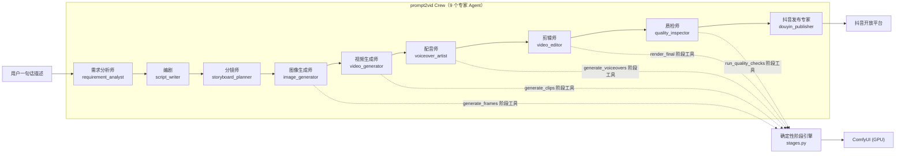

# prompt2vid

> 一句话描述 → 成片自动发布到抖音。基于 **CrewAI 多智能体 + ComfyUI(LTX-Video) + 大模型** 的全自动视频生产流水线。

## 项目简介

prompt2vid 是一个多智能体视频生产系统：用户只需给出一句简单的描述（例如"做一个关于秋天的治愈系短视频"），系统即可自动完成 **需求分析 → 剧本撰写 → 分镜规划 → 图像生成 → 视频生成 → 配音 → 剪辑合成 → 质量检查 → 抖音发布** 的全流程，无需人工介入。

- **多智能体协作**：基于 CrewAI，9 个专家 Agent 顺序流水线协作，每个 Agent / Task 均为独立文件，方便扩展与替换。
- **角色一致性**：分镜表支持 `characters` 角色卡（固定英文外观描述逐字进入每镜 image_prompt，代码兜底补入）；可选开启 IPAdapter 定妆照参考注入，让出场人物全片长相一致。
- **视频生成**：ComfyUI + LTX-Video 2B（RTX 4060 8GB 显存即可运行），文生图（SDXL）+ 图生视频（LTXV）。
- **配音**：edge-tts（免费、支持中文，无需额外 API Key）。
- **剪辑**：ffmpeg 拼接分镜片段、混音、烧录字幕。
- **发布**：抖音开放平台 API；`DOUYIN_DRY_RUN=true` 时仅记录状态不真实上传。
- **部署**：单节点 k8s（ComfyUI 以 GPU Pod 运行，本服务以 kagent BYO Harness 运行），配置开箱即用。

## 架构



**LLM 负责创意，代码负责执行**：需求分析 → 剧本 → 分镜由 LLM agent 生成
（经 file_tool 写入工作目录）；生图、生视频、配音、剪辑、质检五个媒体
阶段由 agent 调用一次性"阶段工具"（`generate_frames` / `generate_clips` /
`generate_voiceovers` / `render_final` / `run_quality_checks`），阶段工具
内部由 `stages.py` 确定性代码**整批提交 ComfyUI**（GPU 队列连续执行）、
自动重试、写 manifest——不依赖 LLM 循环调用工具，不受 agent 迭代上限
约束，也不会编造路径。

两种执行模式（`PROMPT2VID_DIRECT_MEDIA` / CLI `--direct-media`）：
- **crew 模式**（默认）：9 agent 全流程，A2A/kagent 形态；
- **直接媒体模式**：LLM 只做创意三阶段 + 发布，媒体阶段由 `pipeline.py`
  直接驱动 stages——省 6 次 LLM 往返，更快、更省 token、更少故障面。

### Agent 分工

| # | Agent | 职责 | 主要工具 |
|---|-------|------|----------|
| 1 | requirement_analyst 需求分析师 | 解析用户描述，产出结构化视频需求（主题/风格/时长/受众/关键元素） | file_tool（写 requirement.json） |
| 2 | script_writer 编剧 | 根据需求撰写短视频剧本（旁白文案 + 画面描述） | file_tool（写 script.md） |
| 3 | storyboard_planner 分镜师 | 将剧本拆解为分镜表（每镜：画面描述/图生图 prompt/视频运动描述/时长） | file_tool（写 storyboard.json） |
| 4 | image_generator 图像生成师 | 发起批量首帧图生成并汇报结果 | generate_frames（阶段工具） |
| 5 | video_generator 视频生成师 | 发起批量图生视频并汇报结果 | generate_clips（阶段工具） |
| 6 | voiceover_artist 配音师 | 发起批量中文配音并汇报结果 | generate_voiceovers（阶段工具） |
| 7 | video_editor 剪辑师 | 发起确定性剪辑（拼接/对齐/字幕/混流）并汇报结果 | render_final + probe |
| 8 | quality_inspector 质检师 | 发起确定性质检并汇报结论 | run_quality_checks（阶段工具） |
| 9 | douyin_publisher 抖音发布专家 | 撰写标题标签，通过抖音开放平台 API 上传并发布 | DouyinTool |

## 项目结构

```
prompt2vid/
├── .env.example              # 环境变量模板（复制为 .env 并填写）
├── .douyin/state.json        # 抖音发布状态跟踪
├── Dockerfile                 # 本服务镜像（python:3.11-slim + ffmpeg）
├── pyproject.toml
├── config/                    # CrewAI 配置（每个 agent / task 一个 YAML）
│   ├── agents/                # 9 个 agent YAML
│   └── tasks/                 # 9 个 task YAML
├── deploy/
│   ├── comfyui/               # ComfyUI GPU 部署（Dockerfile + k8s 清单 + 模型说明）
│   └── kagent/                # kagent BYO Harness 部署清单（v1alpha3）
├── output/                    # 运行输出目录（每次运行一个 run_<时间戳> 子目录）
├── src/prompt2vid/
│   ├── crew.py                # Crew 构建（加载 config/ 下 YAML，装配工具）
│   ├── main.py                # CLI 入口：python -m prompt2vid.main "描述"
│   ├── server.py              # A2A 服务器（a2a-sdk，kagent 可调用）+ Web 控制台挂载
│   ├── pipeline.py            # 流水线编排（crew/直连模式、续跑、清理、run.log）
│   ├── steps.py               # 分步执行（9 步注册表 + 单步执行器 + steps.json）
│   ├── webui.py               # Web 调试控制台（REST API + 后台执行管理）
│   ├── web/                   # 控制台页面（原生 HTML/JS/CSS，无构建工具）
│   ├── dynamic_llm.py         # LLM 配置（按 agent 覆盖模型，前缀自动补齐+实例缓存）
│   ├── preflight.py           # 环境预检（ComfyUI/模型/节点/ffmpeg）
│   ├── stages.py              # 确定性阶段引擎（批量提交/重试/清单）
│   ├── storyboard.py          # 分镜表宽松解析与修复
│   ├── llm_output.py          # LLM 最终回答的产物抢救（未调用写文件工具时兜底）
│   ├── comfyui_client.py      # ComfyUI HTTP 客户端（连接池/退避轮询/批量等待）
│   ├── tts.py                 # edge-tts 配音纯函数（带回退链）
│   ├── ffmpeg_ops.py          # ffmpeg 剪辑纯函数（探测/拼接/对齐/SRT/混流）
│   ├── workspace.py           # 统一工作目录解析
│   ├── agent-card.json        # A2A Agent Card
│   ├── agents/                # 9 个 agent 定义（每个一个 .py）
│   ├── tasks/                 # 任务装配
│   └── tools/                 # CrewAI 工具薄包装（阶段工具 + 文件/抖音工具）
└── tests/                     # 单元测试 + 端到端冒烟测试
```

## 快速开始（本地）

```bash
# 1. 安装
pip install -e .

# 2. 配置环境变量
cp .env.example .env   # 填写 LLM API Key、ComfyUI 地址等

# 3. 启动 ComfyUI（本地默认 http://127.0.0.1:8188，模型放置见 [docs/LOCAL_SETUP.md](docs/LOCAL_SETUP.md)）

# 4. 预检环境（ComfyUI 可达、三个模型就位、LTXV 节点、ffmpeg 可用）
prompt2vid --check-only

# 5. 运行（默认自动预检，配置问题会在启动几秒内报出）
prompt2vid "做一个关于秋天的治愈系短视频"

# 更快更省 token：直接媒体模式（LLM 只做创意+发布，媒体阶段代码直跑）
prompt2vid "做一个关于秋天的治愈系短视频" --direct-media

# 断点续跑：已生成的帧/片段/配音自动跳过，只补缺失与后续阶段
prompt2vid --resume output/run_20260101_120000 --from render --publish

# 清理旧运行目录（保留最近 5 个）与抖音发布历史
prompt2vid --clean --keep 5
```

每次运行会在 `output/run_<时间戳>/` 下产出：`requirement.json`、`script.md`、`storyboard.json`、`frames/`（分镜首帧）、`clips/`（分镜视频）、`audio/`（配音）、`final/`（成片 + 字幕）、`report/`（质检报告）。

## 分步调试（Web 控制台）

调试时不必整条流水线跑到底——9 个 agent 步骤可以拆开单独执行、单独重跑：

```bash
prompt2vid-server            # 或 python -m prompt2vid.server
# 浏览器打开 http://127.0.0.1:8081/
```

控制台功能：

- 输入一句话描述创建运行（可仅创建 / 立即跑创意三步 / 跑全部）；
- 每一步可单独 **「▶ 此步」** 执行、**「▶ 到最后」** 从该步跑到发布；媒体步骤可 **「↻ 强制」**（先删该阶段产物目录再重跑；不加强制时已生成的分镜文件自动跳过）；
- 步骤状态（未开始 / 运行中 / 完成 / 失败 / 中断）来自 run 目录的 `steps.json` 与产物存在性——**CLI 跑的历史运行也能识别**；
- 实时查看 `run.log` 尾部（2s 轮询）、分镜表（含首帧缩略图）、剧本 / 需求 / 质检报告，`final.mp4` 在线播放；
- 与 A2A 请求共用进程级执行锁，同一时刻只有一个执行流（工作目录经 `PROMPT2VID_WORKSPACE` 进程级环境变量传递，并发会串目录）。

CLI 等价能力（与控制台共用同一条执行路径）：

```bash
prompt2vid --list-steps                                     # 查看步骤 id
prompt2vid "..." --only analyze_requirement,write_script    # 新建运行只跑指定步骤
prompt2vid --resume output/run_xxx --only render --force    # 复用已有产物，强制重跑渲染
```

说明：创意步骤（需求 / 剧本 / 分镜）与发布走 LLM 单任务 crew；媒体五步直接执行 `stages.py` 的确定性函数——与对应 agent 转调的阶段工具是同一实现，只是省掉一次 LLM 往返。

**产物兜底**：小参数本地模型常把 JSON/Markdown 贴在最终回答里而不调用写文件工具。此时创意步骤会尝试从最终回答中抢救产物（`llm_output.py`，JSON 需可解析且 `shots` 非空才落盘，寒暄类回答一律拒绝），抢救成功的步骤在 `steps.json` 的 summary 里带 `⚠ 产物由代码从最终回答抢救写入`。这只影响能否继续往下跑，不保证内容质量——生产环境建议使用支持工具调用的模型。

## k8s 部署（单节点集群）

### 前置条件

- 单节点 k8s 集群（已装 NVIDIA GPU Operator 或 nvidia-container-toolbox）
- StorageClass（用于 ComfyUI 模型/输出 PVC）
- RTX 4060（8GB 显存）+ 64GB 内存宿主机

### 第一步：部署 ComfyUI（GPU Pod）

```bash
# 1. 构建镜像（或直接使用清单中的占位镜像名）
docker build -t your-registry/comfyui:ltx-e8665ca -f deploy/comfyui/Dockerfile deploy/comfyui/

# 2. 创建命名空间与 PVC
kubectl apply -f deploy/comfyui/namespace.yaml
kubectl apply -f deploy/comfyui/pvc.yaml

# 3. 下载模型到 PVC（见 deploy/comfyui/MODELS.md，或用 init 容器/手动挂载）
#    - models/checkpoints/sd_xl_base_1.0.safetensors
#    - models/checkpoints/ltx-video-2b-v0.9.5.safetensors
#    - models/text_encoders/t5xxl_fp8_e4m3fn.safetensors
#    - models/vae/ （LTX VAE 内置于 checkpoint，无需单独文件）

# 4. 部署
kubectl apply -f deploy/comfyui/deployment.yaml
kubectl apply -f deploy/comfyui/service.yaml
```

ComfyUI 在集群内地址为 `http://comfyui.comfyui.svc.cluster.local:8188`（即 `.env` 中 `COMFYUI_URL` 默认值）。

### 第二步：部署 prompt2vid（kagent BYO Harness）

```bash
# 1. 构建并推送本服务镜像（需带 sha256 摘要，Harness 要求）
docker build -t your-registry/prompt2vid:0.1.0 .
docker push your-registry/prompt2vid:0.1.0
# 获取摘要：
docker inspect --format='{{index .RepoDigests 0}}' your-registry/prompt2vid:0.1.0

# 2. 创建凭据 Secret（LLM API Key、抖音凭据）
kubectl apply -f deploy/kagent/secret.yaml   # 按需修改占位值

# 3. 部署 kagent 资源
kubectl apply -f deploy/kagent/modelconfig.yaml
kubectl apply -f deploy/kagent/harness.yaml
kubectl apply -f deploy/kagent/agenttemplate.yaml
kubectl apply -f deploy/kagent/agent.yaml
```

> **注意**：kagent Harness 的 `workload.image` 必须是 sha256 摘要格式（`image@sha256:<64位十六进制>`），清单中为占位符，部署时请替换为你的镜像摘要。Harness 不支持 envFrom/Secret 引用，凭据通过 `secret.yaml` + 部署时替换 env 占位值注入。

### 第三步：触发视频生成

kagent 部署后，可通过 kagent CLI / UI 向 Agent 发送一句话描述：

```bash
kagent agent run prompt2vid --message "做一个关于秋天的治愈系短视频"
```

或直接以 A2A 协议调用：

```bash
curl -X POST http://<pod-ip>:8081/a2a/jsonrpc \
  -H "Content-Type: application/json" \
  -d '{"jsonrpc":"2.0","id":"1","method":"message/send","params":{"message":{"role":"user","parts":[{"kind":"text","text":"做一个关于秋天的治愈系短视频"}]}}}'
```

## 模型下载与放置

> 本地运行的完整配置手册（模型清单、hf-mirror 下载命令、ffmpeg 安装、
> 8GB 显存调优）见 **[docs/LOCAL_SETUP.md](docs/LOCAL_SETUP.md)**；
> ComfyUI 零基础配置指南（哪个节点用哪个模型、文件放哪里）见
> **[docs/deploy.md](docs/deploy.md)**；
> k8s 部署的模型下载见 [deploy/comfyui/MODELS.md](deploy/comfyui/MODELS.md)。

| 模型 | 用途 | 放置路径（ComfyUI PVC 内） | 下载 |
|------|------|--------------------------|------|
| SDXL Base 1.0 | 分镜首帧文生图 | `models/checkpoints/sd_xl_base_1.0.safetensors` | huggingface.co/stabilityai/stable-diffusion-xl-base-1.0 |
| LTX-Video 2B 0.9.5 | 图生视频 | `models/checkpoints/ltx-video-2b-v0.9.5.safetensors` | huggingface.co/Lightricks/LTX-Video |
| T5-XXL fp8 | LTX 文本编码器（8GB 显存必须用 fp8） | `models/text_encoders/t5xxl_fp8_e4m3fn.safetensors` | huggingface.co/comfyanonymous/flux_text_encoders |

> 显存预算：RTX 4060 8GB 下，T5 必须使用 fp8 量化版（fp16 约 9GB+ 会 OOM）；`COMFYUI_T5_DEVICE=cpu` 可进一步把文本编码放到内存（64GB 宿主机内存充足）。

## 抖音开放平台凭据

1. 前往 [抖音开放平台](https://developer.open-douyin.com/) 注册开发者账号并创建应用。
2. 申请「视频发布」能力（需要企业资质审核）。
3. 获取 `client_key` / `client_secret`，并通过 OAuth 流程获取长期 `access_token`。
4. 填入 `.env`：`DOUYIN_CLIENT_KEY` / `DOUYIN_CLIENT_SECRET` / `DOUYIN_ACCESS_TOKEN`。
5. 开发调试阶段保持 `DOUYIN_DRY_RUN=true`——发布专家只把视频记录到 `.douyin/state.json`，不真实上传。

## 环境变量

见 [.env.example](.env.example)。要点：

| 变量 | 说明 |
|------|------|
| `PROMPT2VID_MODEL` | 默认 LLM（LiteLLM 格式，如 `openai/gpt-4o-mini`） |
| `PROMPT2VID_LLM_BASE_URL` / `PROMPT2VID_LLM_API_KEY` | OpenAI 兼容网关地址与密钥 |
| `PROMPT2VID_MODEL__SCRIPT_WRITER` | 按 agent 覆盖模型（agent 名大写、点换双下划线） |
| `COMFYUI_URL` | ComfyUI 服务地址（本地默认 `http://127.0.0.1:8188`） |
| `COMFYUI_T2I_CHECKPOINT` / `COMFYUI_LTX_CHECKPOINT` / `COMFYUI_T5` | ComfyUI 模型文件名（5090/24GB+ 建议 `ltxv-13b-0.9.7-distilled-fp8`；2B 档已回退兜底） |
| `COMFYUI_T2I_WIDTH` / `COMFYUI_T2I_HEIGHT` | 首帧画幅（默认 768x1344 竖屏；视频画幅会跟随首帧自动换算成 32 的倍数，避免人物被裁变形） |
| `COMFYUI_T2I_STEPS` / `COMFYUI_LTX_STEPS` / `COMFYUI_LTX_CFG` | 采样步数/cfg（SDXL 默认 25；LTX 留空按模型自动：distilled → cfg 1.0 / 8 步，13B dev → cfg 3.0 / 30 步，2B → cfg 3.0 / 10 步） |
| `COMFYUI_LTX_MAX_PIXELS` / `COMFYUI_LTX_WIDTH` / `COMFYUI_LTX_HEIGHT` | LTX 单帧像素预算（2B 默认 512x768，13B 自动 576x1024；可设 921600 上 720p）或显式固定画幅（32 倍数） |
| `COMFYUI_LTX_PROMPT_SUFFIX` | 追加到 LTX 正向提示词的肢体稳定约束（默认 `consistent anatomy, natural body proportions, stable limbs, detailed hands`） |
| `COMFYUI_RETRIES` | 单镜生成失败重试次数（默认 2，按批次重试） |
| `COMFYUI_IPADAPTER` | true 时启用角色一致性参考注入（分镜表含 `characters` 时先生成角色定妆照，出镜分镜首帧注入参考；需 ComfyUI 装 ComfyUI_IPAdapter_plus + 两个模型，见 [docs/LOCAL_SETUP.md](docs/LOCAL_SETUP.md) 第 6 节；未就位时自动回退无参考生成） |
| `COMFYUI_IPADAPTER_PRESET` / `COMFYUI_IPADAPTER_WEIGHT` | IPAdapter 预设与注入权重（默认 `PLUS FACE (portraits)` / 0.8） |
| `COMFYUI_LTX_FPS` / `COMFYUI_LTX_MAX_FRAMES` | LTX 帧率（25）与单镜帧数上限（121，帧数自动满足 8n+1） |
| `PROMPT2VID_SEED` | 固定种子复现（逐镜 +1；不设则随机） |
| `PROMPT2VID_DIRECT_MEDIA` | true 时直接媒体模式（LLM 只做创意+发布） |
| `PROMPT2VID_BGM` / `PROMPT2VID_BGM_VOLUME` | 可选背景音乐文件与音量（默认 0.25） |
| `PROMPT2VID_SUBTITLE_STYLE` | 字幕烧录样式（libass force_style） |
| `PROMPT2VID_FFMPEG` / `PROMPT2VID_FFPROBE` | 指定 ffmpeg/ffprobe 可执行文件路径（不设则按 PATH → 常见目录 → 随包二进制查找；ffprobe 缺失时探测自动回退解析 ffmpeg 输出） |
| `DOUYIN_DRY_RUN` | true 时抖音发布仅记录状态 |

## 测试

```bash
pip install -e ".[dev]"
pytest tests/ -v
```

> 本地无 ffmpeg/ffprobe 时渲染/质检集成测试自动 skip；想在本机跑通渲染可
> `pip install -e ".[local-media]"`（随包静态 ffmpeg，探测走 ffmpeg 回退），
> 或按 [docs/LOCAL_SETUP.md](docs/LOCAL_SETUP.md) 5.1 安装系统 ffmpeg。
> GitHub Actions（[.github/workflows/ci.yml](.github/workflows/ci.yml)）会安装
> ffmpeg + CJK 字体跑全量测试。

## License

MIT
