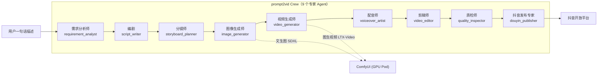

# prompt2vid

> 一句话描述 → 成片自动发布到抖音。基于 **CrewAI 多智能体 + ComfyUI(LTX-Video) + 大模型** 的全自动视频生产流水线。

## 项目简介

prompt2vid 是一个多智能体视频生产系统：用户只需给出一句简单的描述（例如"做一个关于秋天的治愈系短视频"），系统即可自动完成 **需求分析 → 剧本撰写 → 分镜规划 → 图像生成 → 视频生成 → 配音 → 剪辑合成 → 质量检查 → 抖音发布** 的全流程，无需人工介入。

- **多智能体协作**：基于 CrewAI，9 个专家 Agent 顺序流水线协作，每个 Agent / Task 均为独立文件，方便扩展与替换。
- **视频生成**：ComfyUI + LTX-Video 2B（RTX 4060 8GB 显存即可运行），文生图（SDXL）+ 图生视频（LTXV）。
- **配音**：edge-tts（免费、支持中文，无需额外 API Key）。
- **剪辑**：ffmpeg 拼接分镜片段、混音、烧录字幕。
- **发布**：抖音开放平台 API；`DOUYIN_DRY_RUN=true` 时仅记录状态不真实上传。
- **部署**：单节点 k8s（ComfyUI 以 GPU Pod 运行，本服务以 kagent BYO Harness 运行），配置开箱即用。

## 架构



### Agent 分工

| # | Agent | 职责 | 主要工具 |
|---|-------|------|----------|
| 1 | requirement_analyst 需求分析师 | 解析用户描述，产出结构化视频需求（主题/风格/时长/受众/关键元素） | 无（纯 LLM） |
| 2 | script_writer 编剧 | 根据需求撰写短视频剧本（旁白文案 + 画面描述） | 无（纯 LLM） |
| 3 | storyboard_planner 分镜师 | 将剧本拆解为分镜表（每镜：画面描述/图生图 prompt/视频运动描述/时长） | 无（纯 LLM） |
| 4 | image_generator 图像生成师 | 为每个分镜生成首帧图（ComfyUI SDXL 文生图） | ComfyUITool |
| 5 | video_generator 视频生成师 | 将首帧图转为视频片段（ComfyUI LTX-Video 图生视频） | ComfyUITool |
| 6 | voiceover_artist 配音师 | 为剧本生成中文配音（edge-tts），产出每镜音频 | EdgeTTSTool |
| 7 | video_editor 剪辑师 | ffmpeg 拼接片段、混音、烧录字幕，产出最终成片 | FFmpegTool |
| 8 | quality_inspector 质检师 | 校验成片存在/时长/音轨/分辨率，输出质检报告 | FileTool |
| 9 | douyin_publisher 抖音发布专家 | 通过抖音开放平台 API 上传并发布，记录状态到 .douyin/state.json | DouyinTool |

## 项目结构

```
prompt2vid/
├── .env.example              # 环境变量模板（复制为 .env 并填写）
├── .douyin/state.json        # 抖音发布状态跟踪
├── Dockerfile                 # 本服务镜像（python:3.11-slim + ffmpeg）
├── pyproject.toml
├── config/                    # CrewAI 配置（每个 agent / task 一个 YAML）
│   ├── agents/                # 9 个 agent YAML
│   └── tasks/                 # 9 个 task YAML
├── deploy/
│   ├── comfyui/               # ComfyUI GPU 部署（Dockerfile + k8s 清单 + 模型说明）
│   └── kagent/                # kagent BYO Harness 部署清单（v1alpha3）
├── output/                    # 运行输出目录（每次运行一个 run_<时间戳> 子目录）
├── src/prompt2vid/
│   ├── crew.py                # Crew 构建（加载 config/ 下 YAML）
│   ├── main.py                # CLI 入口：python -m prompt2vid.main "描述"
│   ├── server.py              # A2A 服务器（a2a-sdk，kagent 可调用）
│   ├── dynamic_llm.py         # LLM 配置（支持按 agent 覆盖模型）
│   ├── agent-card.json        # A2A Agent Card
│   ├── agents/                # 9 个 agent 定义（每个一个 .py）
│   ├── tasks/                 # 任务装配
│   └── tools/                 # ComfyUI / edge-tts / ffmpeg / 抖音 / 文件工具
└── tests/                     # 单元测试 + 端到端冒烟测试
```

## 快速开始（本地）

```bash
# 1. 安装
pip install -e .

# 2. 配置环境变量
cp .env.example .env   # 填写 LLM API Key、ComfyUI 地址等

# 3. 启动 ComfyUI（本地或 k8s，见下文部署章节）

# 4. 运行
prompt2vid "做一个关于秋天的治愈系短视频"
# 或
python -m prompt2vid.main "做一个关于秋天的治愈系短视频"
```

每次运行会在 `output/run_<时间戳>/` 下产出：`requirement.json`、`script.md`、`storyboard.json`、`frames/`（分镜首帧）、`clips/`（分镜视频）、`audio/`（配音）、`final/`（成片 + 字幕）、`report/`（质检报告）。

## k8s 部署（单节点集群）

### 前置条件

- 单节点 k8s 集群（已装 NVIDIA GPU Operator 或 nvidia-container-toolbox）
- StorageClass（用于 ComfyUI 模型/输出 PVC）
- RTX 4060（8GB 显存）+ 64GB 内存宿主机

### 第一步：部署 ComfyUI（GPU Pod）

```bash
# 1. 构建镜像（或直接使用清单中的占位镜像名）
docker build -t your-registry/comfyui:ltx-e8665ca -f deploy/comfyui/Dockerfile deploy/comfyui/

# 2. 创建命名空间与 PVC
kubectl apply -f deploy/comfyui/namespace.yaml
kubectl apply -f deploy/comfyui/pvc.yaml

# 3. 下载模型到 PVC（见 deploy/comfyui/MODELS.md，或用 init 容器/手动挂载）
#    - models/checkpoints/sd_xl_base_1.0.safetensors
#    - models/checkpoints/ltx-video-2b-v0.9.5.safetensors
#    - models/text_encoders/t5xxl_fp8_e4m3fn.safetensors
#    - models/vae/ （LTX VAE 内置于 checkpoint，无需单独文件）

# 4. 部署
kubectl apply -f deploy/comfyui/deployment.yaml
kubectl apply -f deploy/comfyui/service.yaml
```

ComfyUI 在集群内地址为 `http://comfyui.comfyui.svc.cluster.local:8188`（即 `.env` 中 `COMFYUI_URL` 默认值）。

### 第二步：部署 prompt2vid（kagent BYO Harness）

```bash
# 1. 构建并推送本服务镜像（需带 sha256 摘要，Harness 要求）
docker build -t your-registry/prompt2vid:0.1.0 .
docker push your-registry/prompt2vid:0.1.0
# 获取摘要：
docker inspect --format='{{index .RepoDigests 0}}' your-registry/prompt2vid:0.1.0

# 2. 创建凭据 Secret（LLM API Key、抖音凭据）
kubectl apply -f deploy/kagent/secret.yaml   # 按需修改占位值

# 3. 部署 kagent 资源
kubectl apply -f deploy/kagent/modelconfig.yaml
kubectl apply -f deploy/kagent/harness.yaml
kubectl apply -f deploy/kagent/agenttemplate.yaml
kubectl apply -f deploy/kagent/agent.yaml
```

> **注意**：kagent Harness 的 `workload.image` 必须是 sha256 摘要格式（`image@sha256:<64位十六进制>`），清单中为占位符，部署时请替换为你的镜像摘要。Harness 不支持 envFrom/Secret 引用，凭据通过 `secret.yaml` + 部署时替换 env 占位值注入。

### 第三步：触发视频生成

kagent 部署后，可通过 kagent CLI / UI 向 Agent 发送一句话描述：

```bash
kagent agent run prompt2vid --message "做一个关于秋天的治愈系短视频"
```

或直接以 A2A 协议调用：

```bash
curl -X POST http://<pod-ip>:8081/a2a/jsonrpc \
  -H "Content-Type: application/json" \
  -d '{"jsonrpc":"2.0","id":"1","method":"message/send","params":{"message":{"role":"user","parts":[{"kind":"text","text":"做一个关于秋天的治愈系短视频"}]}}}'
```

## 模型下载与放置

| 模型 | 用途 | 放置路径（ComfyUI PVC 内） | 下载 |
|------|------|--------------------------|------|
| SDXL Base 1.0 | 分镜首帧文生图 | `models/checkpoints/sd_xl_base_1.0.safetensors` | huggingface.co/stabilityai/stable-diffusion-xl-base-1.0 |
| LTX-Video 2B 0.9.5 | 图生视频 | `models/checkpoints/ltx-video-2b-v0.9.5.safetensors` | huggingface.co/Lightricks/LTX-Video |
| T5-XXL fp8 | LTX 文本编码器（8GB 显存必须用 fp8） | `models/text_encoders/t5xxl_fp8_e4m3fn.safetensors` | huggingface.co/comfyanonymous/flux_text_encoders |

> 显存预算：RTX 4060 8GB 下，T5 必须使用 fp8 量化版（fp16 约 9GB+ 会 OOM）；`COMFYUI_T5_DEVICE=cpu` 可进一步把文本编码放到内存（64GB 宿主机内存充足）。

## 抖音开放平台凭据

1. 前往 [抖音开放平台](https://developer.open-douyin.com/) 注册开发者账号并创建应用。
2. 申请「视频发布」能力（需要企业资质审核）。
3. 获取 `client_key` / `client_secret`，并通过 OAuth 流程获取长期 `access_token`。
4. 填入 `.env`：`DOUYIN_CLIENT_KEY` / `DOUYIN_CLIENT_SECRET` / `DOUYIN_ACCESS_TOKEN`。
5. 开发调试阶段保持 `DOUYIN_DRY_RUN=true`——发布专家只把视频记录到 `.douyin/state.json`，不真实上传。

## 环境变量

见 [.env.example](.env.example)。要点：

| 变量 | 说明 |
|------|------|
| `PROMPT2VID_MODEL` | 默认 LLM（LiteLLM 格式，如 `openai/gpt-4o-mini`） |
| `PROMPT2VID_LLM_BASE_URL` / `PROMPT2VID_LLM_API_KEY` | OpenAI 兼容网关地址与密钥 |
| `PROMPT2VID_MODEL__SCRIPT_WRITER` | 按 agent 覆盖模型（agent 名大写、点换双下划线） |
| `COMFYUI_URL` | ComfyUI 服务地址 |
| `COMFYUI_T2I_CHECKPOINT` / `COMFYUI_LTX_CHECKPOINT` / `COMFYUI_T5` | ComfyUI 模型文件名 |
| `DOUYIN_DRY_RUN` | true 时抖音发布仅记录状态 |

## 测试

```bash
pip install -e ".[dev]"
pytest tests/ -v
```

## License

MIT
